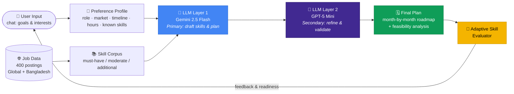
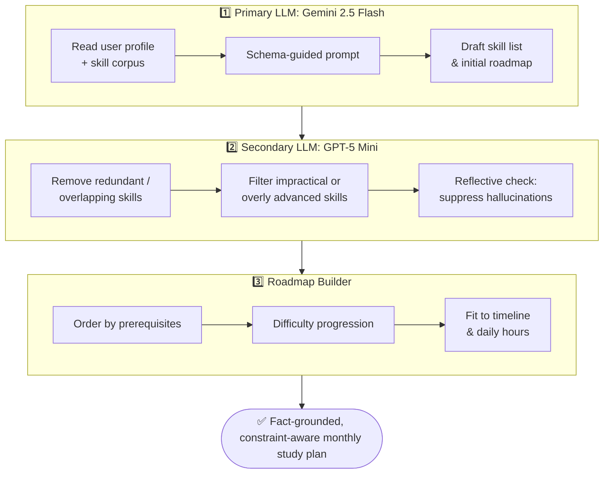
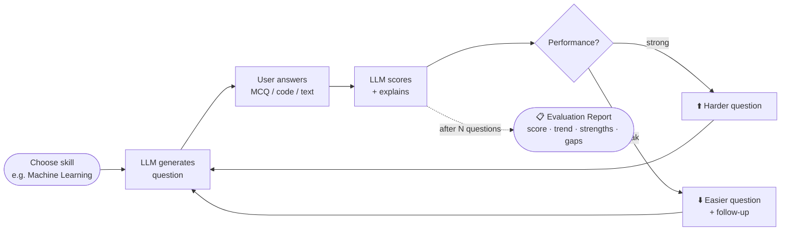
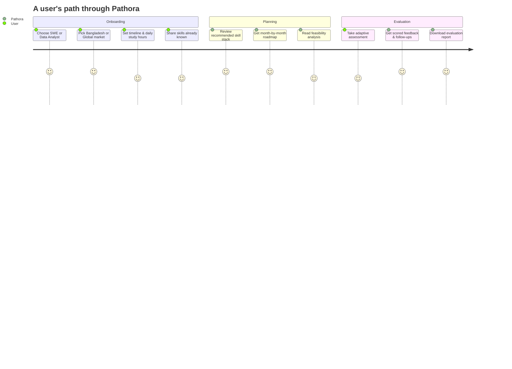
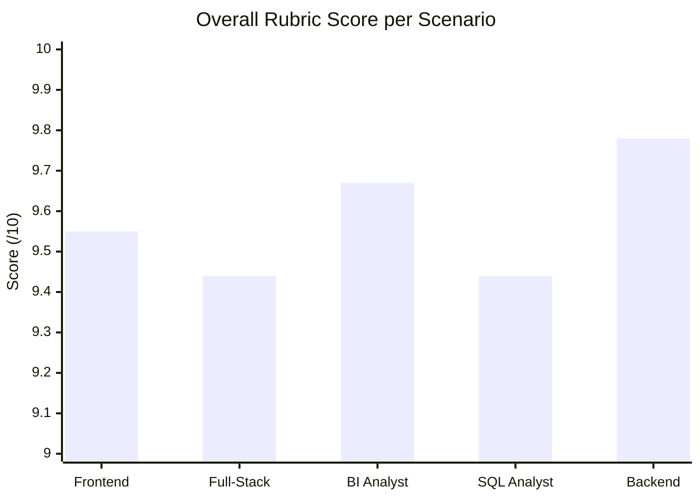
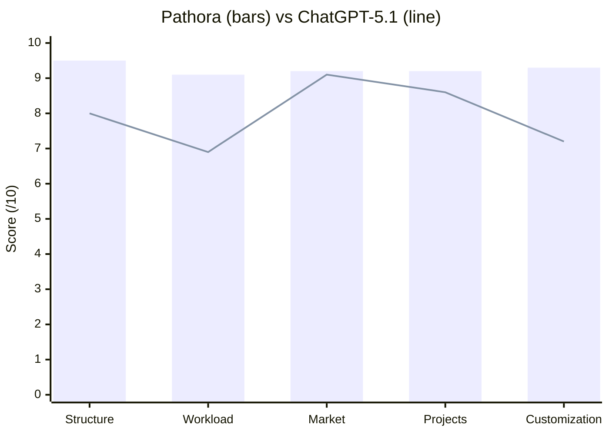
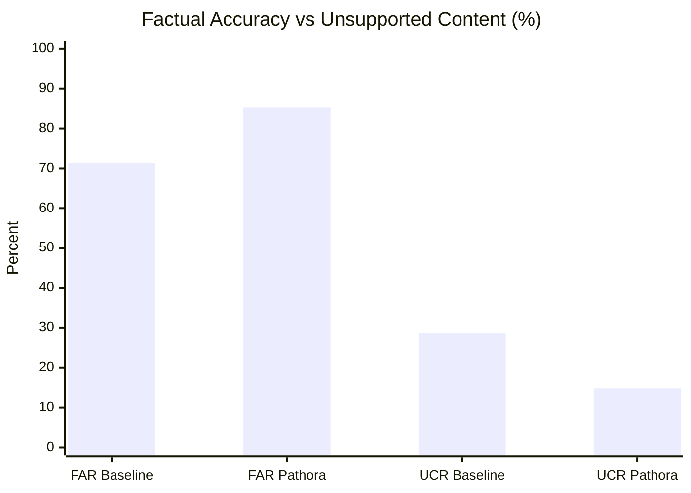

<div align="center">

# 🧭 Pathora

### AI-Powered Career Guidance & Adaptive Skill Evaluation System

*Personalized, market-aligned learning roadmaps for **Software Engineering** and **Data Analyst** careers, from beginner to job-ready.*


[Overview](#-overview) •
[Features](#-key-features) •
[How It Works](#️-how-it-works) •
[Results](#-results) •
[Demo](#-demo) •
[Getting Started](#-getting-started)

</div>

---

## 📖 Overview

Many fresh graduates, especially in **Bangladesh**, finish university without the skills employers actually ask for. Existing platforms solve only pieces of the problem: generic course suggestions, basic MCQ tests, or resume templates. None of them offers a **complete, end-to-end** career-building path grounded in real job-market data.

**Pathora** fills that gap. It talks with you to understand your goals, background and available time. It then builds a **month-by-month learning roadmap** from real job postings, and checks your readiness with **interview-style adaptive assessments**.

> **In one sentence:** Tell Pathora what job you want, which market you're targeting and how much time you have. It tells you exactly what to learn, in what order, and whether you're ready.

### 📄 Abstract

> The shortage of job-ready software professionals reflects a persistent gap between university training and industry expectations. This paper presents an AI-driven Career Guidance System that uses Large Language Models (LLMs) and real job-market data to generate personalized learning plans for Software Engineering and Data Analyst roles. The system analyzes **400 job postings** from global and Bangladeshi markets to construct employer-aligned skill corpora and employs a multi-stage LLM pipeline combining **Gemini 2.5 Flash** and **GPT-5 Mini** as Primary and Secondary LLMs. Through schema-guided and reflective prompt engineering, the pipeline produces fact-grounded, constraint-aware monthly study plans while **reducing hallucination by 48.5%**. A second module provides adaptive skill evaluation through iterative LLM-generated questions, scoring, and difficulty adjustment. The system was assessed using rubric-based scoring and cross-agent comparison across five scenarios, achieving consistently high scores (**9.44–9.78 / 10**) and **outperforming a ChatGPT-5.1 application (46.3 vs. 39.8)**.

---

## ✨ Key Features

| | Feature | What it does |
|:-:|---|---|
| 🎯 | **Market-Aligned Skills** | Analyzes real postings from **LinkedIn, BDjobs, Glassdoor and Aijobs.net** and sorts skills into *must-have*, *moderately needed* and *additional* |
| 🗺️ | **Personalized Career Pathways** | A chat interface collects your target role, market (Bangladesh / Global), timeline, daily study hours and existing skills, then generates a custom roadmap |
| ✂️ | **No Redundant Learning** | Groups overlapping skills (e.g. Java / C# / Python for backend) and recommends only the most valuable ones |
| 📊 | **Feasibility Analysis** | Checks whether the plan actually fits your available hours and suggests alternatives if it doesn't |
| 🎤 | **Interview-Like Assessments** | Generates technical and behavioral questions (MCQ, coding, open-ended), scores them, explains the answer and adjusts difficulty as you go |
| 📈 | **Progress & Readiness Tracking** | Tracks task completion and assessment performance to estimate your time to job-readiness |

**Target domains:** 💻 Software Engineering (Frontend · Backend · Full-Stack) and 📊 Data Analysis (BI Analyst · SQL Analyst)

---

## ⚙️ How It Works

### High-Level Architecture



### The Multi-LLM Reasoning Pipeline

Pathora doesn't trust a single LLM call. It uses **two models with different roles**:



### Adaptive Skill Evaluation Loop



### User Journey



---

## 📊 Results

We tested Pathora on **five realistic user scenarios**. All scoring was done by **Claude Sonnet 4.5**, prompted as an independent curriculum reviewer to keep evaluation consistent and low-bias.

| # | Scenario | Market | Constraint |
|:-:|---|---|---|
| 1 | Frontend SWE | International | 5 months |
| 2 | Full-Stack SWE | Bangladesh | 6 months |
| 3 | BI Data Analyst | Global | 4 months, prefers Python |
| 4 | SQL Analyst | n/a | 2 hrs/day study |
| 5 | Backend SWE | Bangladesh | 6 months |

### 1️⃣ Rubric-Based Evaluation (scale 1–10)

Each generated plan was graded on rubric dimensions taken from curriculum-design and LLM-evaluation literature.

| Dimension | Test 1 | Test 2 | Test 3 | Test 4 | Test 5 |
|---|:-:|:-:|:-:|:-:|:-:|
| Relevance | 8 | 9 | 10 | 10 | 10 |
| Market Alignment | 10 | 10 | 10 | 9 | 10 |
| Coverage | 10 | 10 | 10 | 9 | 10 |
| Feasibility | 8 | 8 | 8 | 10 | 9 |
| Structure | 10 | 10 | 10 | 10 | 10 |
| Job Readiness | 10 | 10 | 10 | 9 | 10 |
| Clarity | 8 | 8 | 9 | 8 | 9 |
| Reasoning | 10 | 10 | 10 | 10 | 10 |
| **Overall** | **9.55** | **9.44** | **9.67** | **9.44** | **🏆 9.78** |



> 💡 **Backend SWE scored highest (9.78)** because it covered cloud services, CI/CD and security. The **SQL Analyst** plan was rated the most realistic for someone with only 2 hrs/day. The **Frontend** plan scored slightly lower on personalization, which points to room for better customization for users who already have some experience.

### 2️⃣ Pathora vs. ChatGPT (GPT-5.1)

Both systems got the same five scenarios and were scored 0–10 on five criteria.

| Criterion | 🧭 Pathora | 🤖 ChatGPT-5.1 | Δ |
|---|:-:|:-:|:-:|
| Structural Coherence | **9.5** | 8.0 | +1.5 |
| Workload Realism | **9.1** | 6.9 | **+2.2** |
| Market Alignment | **9.2** | 9.1 | +0.1 |
| Quality of Suggested Projects | **9.2** | 8.6 | +0.6 |
| Customization Fidelity | **9.3** | 7.2 | **+2.1** |
| **Total (/50)** | **46.3** | 39.8 | **+6.5** |



> 💡 The biggest gaps are in **workload realism** and **customization**. ChatGPT often produced plans that were hard to follow in real life, while Pathora's plans stayed within the user's actual time budget.

### 3️⃣ Hallucination Evaluation

Every factual claim in a plan was checked against the skill corpus and the user's preferences using three corpus-grounded metrics:

- **FAR**: Factual Accuracy Rate (higher is better)
- **UCR**: Unsupported Content Rate (lower is better)
- **ICS**: Instruction Constraint Satisfaction, out of 5 (higher is better)

| Metric | Baseline | Pathora | Improvement |
|---|:-:|:-:|:-:|
| FAR ⬆️ | 71.30% | **85.22%** | ✅ +19.5% |
| UCR ⬇️ | 28.66% | **14.75%** | ✅ **48.5% reduction** |
| ICS ⬆️ | 4.00 | **4.67** | ✅ +0.67 |



> ✅ Schema-guided + reflective prompt engineering across two LLMs **almost halves unsupported content** and produces more reliable, user-aligned plans.

---

## 🎬 Demo

<div align="center">

https://github.com/USERNAME/REPO/assets/demo.mp4

<sub>▶️ Replace the link above with your uploaded demo video (drag the .mp4 into a GitHub issue or README edit box to get a URL).</sub>

</div>

### Screenshots

<table>
  <tr>
    <td align="center"><br/><b>Landing page</b></td>
    <td align="center"><br/><b>How the AI system works</b></td>
  </tr>
  <tr>
    <td align="center"><br/><b>Conversational onboarding</b></td>
    <td align="center"><br/><b>Personalized learning plan</b></td>
  </tr>
  <tr>
    <td align="center"><br/><b>Feasibility analysis & recommendations</b></td>
    <td align="center"><br/><b>Adaptive assessment with instant scoring</b></td>
  </tr>
  <tr>
    <td align="center" colspan="2"><br/><b>Final evaluation report: score, difficulty trend, per-question feedback</b></td>
  </tr>
</table>

---

## 🚀 Getting Started

> ⚠️ **Update this section** with your actual stack, folder names and commands.

### Prerequisites
- API key for **Google Gemini** (Primary LLM)
- API key for **OpenAI** (Secondary LLM)

### Installation

```bash
# 1. Clone the repository
git clone https://github.com/USERNAME/pathora.git
cd pathora

# 2. Install dependencies
#    (e.g. pip install -r requirements.txt  /  npm install)

# 3. Add your API keys
cp .env.example .env
#    GEMINI_API_KEY=your_key_here
#    OPENAI_API_KEY=your_key_here

# 4. Run the app
#    (e.g. python app.py  /  npm run dev)
```

### Usage
1. Open the app and click **Access the System**.
2. Choose **Software Engineering** or **Data Analyst**, then pick the **Bangladesh** or **Global** market.
3. Enter your timeline, daily study hours and any skills you already know.
4. Review your **recommended skill stack** and **month-by-month roadmap**. Export it as a PDF if you like.
5. Open the **Skill Evaluator**, pick a skill and take the adaptive assessment.
6. Read your **evaluation report** for strengths, gaps and follow-up questions.

---

## 🗂️ Project Structure

```text
pathora/
├── assets/              # Screenshots & figures used in this README
├── data/                # Collected job postings & skill corpora   (update)
├── ...                  # Your source folders here                 (update)
└── README.md
```

---

## 🔮 Future Work

- Extend beyond SWE and Data Analyst to more job domains
- Deeper personalization for users with prior experience (the weakest rubric area in testing)
- Continuously refreshed job-market data
- Human-expert evaluation alongside LLM-based scoring

---

## 📚 Citation

If you use Pathora in your research, please cite:

```bibtex
@misc{pathora,
  title  = {Pathora: AI-Powered Career Guidance and Adaptive Skill Evaluation System},
  author = {Lishad, Aurongojeb and others},
  year   = {2025},
  note   = {Update with venue / DOI}
}
```

---

<div align="center">

**Built to close the gap between university and industry 🎓 ➜ 💼**

⭐ If you find this project useful, consider giving it a star!

</div>
