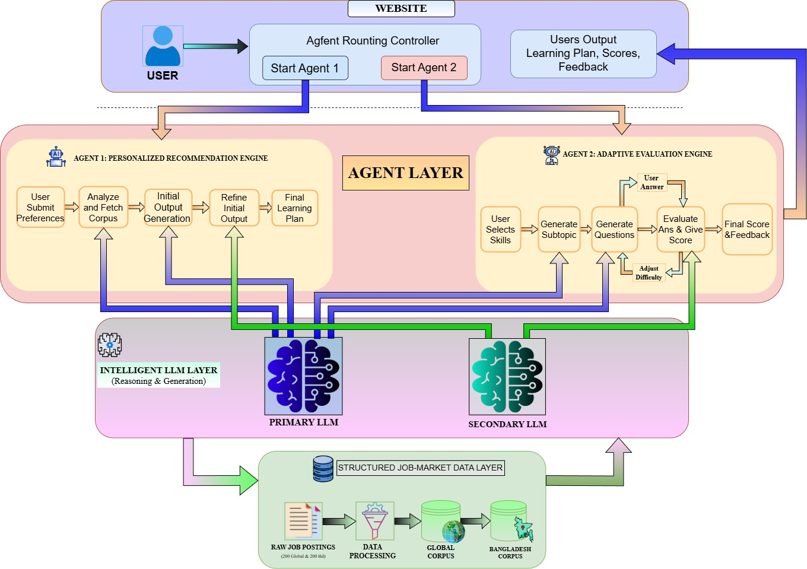

<div align="center">


# Pathora

### AI-powered career guidance, from beginner to job-ready

<p>
  
  
  
</p>

<a href="https://YOUR-PATHORA-WEBSITE.com">
  
</a>

</div>

<br/>

## About

> Pathora is an AI career agent for aspiring **Software Engineers** and **Data Analysts**.
> Tell it the job you want, which market you're targeting and how much time you have. It tells you **what to learn, in what order**, and **whether you're ready**.

<br/>

## The Problem

- Many graduates finish university without the skills employers actually ask for.
- Online course lists are generic and don't follow the real job market.
- Roadmaps are one-size-fits-all and ignore your goal, background and available time.
- Learners waste months on overlapping skills that add little value.
- Skill tests are mostly MCQs that don't feel like real interviews.
- General AI chatbots can give confident but wrong career advice.

<br/>

## What Pathora Does

- Recommends skills taken from **real job postings** in the Bangladeshi and global markets.
- Builds a **month-by-month roadmap** around your goal, timeline and daily study hours.
- Groups overlapping skills and keeps **only the ones that matter**.
- Checks whether your plan is **realistic** for the time you have.
- Runs **interview-style assessments** that adapt in difficulty and explain every answer.
- Uses **two LLMs that double-check each other** to cut down wrong or made-up advice.

<br/>

## System Overview

<div align="center">
  
</div>

<br/>

<table>
  <tr>
    <td width="33%" valign="top">
      <b>01 &nbsp;Chat</b><br/>
      <sub>Pathora asks about your goal, target market, timeline and daily study hours.</sub>
    </td>
    <td width="33%" valign="top">
      <b>02 &nbsp;Plan</b><br/>
      <sub>LLM 1 drafts your skills and roadmap from job-market data. LLM 2 removes redundant, impractical or unsupported content.</sub>
    </td>
    <td width="33%" valign="top">
      <b>03 &nbsp;Practice</b><br/>
      <sub>Interview-style questions are scored and explained, and the difficulty adjusts to how you do.</sub>
    </td>
  </tr>
</table>

<br/>

## Key Results

<table>
  <tr>
    <td align="center" width="33%">
      <h1>↓ 48.5%</h1>
      <b>Hallucination</b><br/>
      <sub>Almost half the made-up content removed</sub>
    </td>
    <td align="center" width="33%">
      <h1>↑ 19.5%</h1>
      <b>Factual Accuracy</b><br/>
      <sub>85% of claims backed by real data</sub>
    </td>
    <td align="center" width="33%">
      <h1>9.8<sub>/10</sub></h1>
      <b>Market Alignment</b><br/>
      <sub>Skills match what employers want</sub>
    </td>
  </tr>
  <tr>
    <td align="center">
      <h1>9.1<sub>/10</sub></h1>
      <b>Workload Realism</b><br/>
      <sub>Plans you can actually follow</sub>
    </td>
    <td align="center">
      <h1>4.67<sub>/5</sub></h1>
      <b>Constraint Adherence</b><br/>
      <sub>Respects your time and preferences</sub>
    </td>
    <td align="center">
      <h1>+16%</h1>
      <b>vs ChatGPT-5.1</b><br/>
      <sub>Higher overall plan quality</sub>
    </td>
  </tr>
</table>

<br/>

## Project Structure

```
app.py                    Web entrypoint, mounts both agent APIs
local.py                  Runs the full site on your machine
public/                   Website (landing page, career chat, skill evaluation)
career_guidance_agent/    Agent 1: skill recommendation and learning plan
ques_ans_agent/           Agent 2: adaptive skill assessment
```

<br/>

## Run Locally

```bash
python -m venv .venv
source .venv/bin/activate        # Windows: .venv\Scripts\activate
pip install -r requirements.txt
cp .env.example .env             # then add your API keys
python local.py
```

Open http://127.0.0.1:8000

<br/>

## Deploy on Vercel

1. Push this repository to GitHub.
2. In Vercel, choose **Add New → Project** and import the repository. Keep the default settings.
3. Under **Environment Variables**, add `OPENAI_API_KEY` and `GOOGLE_API_KEY`.
4. Click **Deploy**.
5. Open the project's **Storage** tab, create an **Upstash for Redis** database (free plan), connect it to the project and redeploy. This keeps each visitor's session available across serverless instances.

<br/>

<div align="center">

<a href="https://YOUR-PATHORA-WEBSITE.com">
  
</a>

</div>
